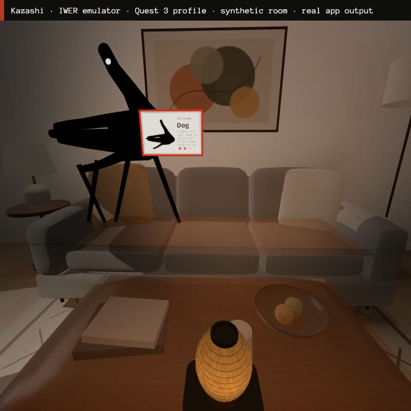

# Kazashi (翳し)

*"Holding your hand up to the light."* A mixed-reality shadow theatre for Meta Quest 3/3S, built with the
Immersive Web SDK (WebXR).

A paper lantern sits on your real desk. Raise your hand over it and its shadow falls on your real wall. Shape a
dog, hold it until the ring fills, and the shadow inks into a living dog: it peels off the wall, grows legs, trots
to the end of the wall and leaps the corner. Two hands make a heron that flies up the wall onto the ceiling.
Collect the cast, then stage a 20-second play and keep the take.

Meta VR Start 2026 · Track: Entertainment · Division: New Experience · Award target: Boldest Original Concept.
Spec: `grokbot/specs/meta-vr/kazashi.md`.



Clips (IWER emulator, real app output, emulated hands): `grokbot/videos/kazashi/kazashi-whoa.mp4` (22 s),
`kazashi-theatre.mp4` (26 s), `kazashi-shoji.mp4` (21 s).

## How it plays

| Moment | What you do (hands only) |
|---|---|
| Start | Tap *Enter the theatre*. The room dims to dusk; the lantern appears on the desk within reach. |
| Make a shadow | Hold a hand between the lantern and the wall. The shadow is cast by the lantern's own light. |
| Ink a creature | Match the shape on the kamishibai card. Hold ≥ 80 % (adjustable) for 1.2 s; the vermilion ring fills. |
| Change the size | Pinch-grab the lantern and move it. Act III needs giants (hands near the lantern) or small things (far). |
| Hint, retry, next | Poke the paper tabs on the lantern stand (≥ 3 cm), or point and pinch. Thumb swipe left/right also works (unverified on hardware). |
| Menu | Turn your left palm up: acts, free shadows, today's silhouette, theatre, play, record, tolerance, one-hand mode, high contrast, glasses layout, re-place lantern, exit. |
| Theatre | Pinch a glass slide from the cast strip and let go in front of the lantern: it is projected onto the wall. Part your hands like a curtain and close them to start and stop a 20 s take. Up to 5 takes are kept (IndexedDB) and replay through the same shadow and creature rigs. |
| No wall? | After 5 s without a wall, a shoji screen follows your view; pinch once to stand it. |

Onboarding has no wall of text: the first three cards (bird, dog, rabbit) show a glowing ghost hand exactly where your
hand should go.

## What is in the box

```
packages/core      pure TypeScript, no renderer: shadow rasteriser + IoU matcher, hold-to-ink tracker,
                   room reading (unlabelled planes), takes, daily seed, creature mesh + rig data, the cast
packages/app       the IWSDK app (systems, procedural lantern, shaders, synthesised audio) + emulator e2e
packages/landing   one-page site in the brand (kamishibai stage), silhouettes drawn from the cast data
e2e-results/       the latest emulator e2e results (JSON) and the glasses field-of-view screenshot
```

- **Analytic shadow, no GPU readback.** 25 joints per hand become tapered bone capsules and a palm polygon,
  projected through the lantern (a pinhole) onto the wall, rasterised into 64 × 64 bits at 15 Hz, normalised for
  centroid and area and scored by IoU with ±10° of roll. 0.1–0.2 ms per scoring tick on the desktop.
- **The shadow you see is the shape being scored.** An invisible proxy (instanced joint spheres, bone cylinders,
  palm prisms with the same radii) casts the lantern's one 512² spot shadow onto a `ShadowMaterial` on the wall. It
  also writes depth, so your real hands stay in front of the dusk overlay and the wall art.
- **Real room, no labels.** Planes are classified by orientation, height and size (floor, ceiling, wall ≥ 1 m,
  desk 0.3–1.25 m). The lantern goes on a desk within reach; the lit wall is the one the lantern's aim ray hits.
  Creatures run along the wall's real extent and jump to an adjacent wall or the ceiling within 0.8 m.
- **Passthrough is never touched.** Dusk and lamplight are alpha-blended quads drawn on detected planes.
- **The cast was authored in the emulator.** 1212 IWER hand recipes were played and captured as joint poses; a
  randomised max-independent-set search picked 25 whose shadows score ≤ 0.45 against each other
  (`packages/core/targets`, `scripts/mis.ts`). Each target runs through the same rasteriser as live hands, so it is
  reachable by construction. The ink then "dresses" the silhouette: an eye at the head and, for walkers, legs.
- **Glasses.** On Meta VR Glasses (gaze-tracking granted) the card, gaze buttons and menu move inside the narrow
  view and work with gaze + pinch. Quest 3 has no eye tracking, so there it is poke and hand ray + pinch; Kazashi has
  no head-gaze.
- Procedural assets only (lathe lantern, canvas washi, shaders), synthesised audio (Karplus-Strong koto, noise
  rustle, ink bleed), OFL fonts (Bricolage Grotesque, Anonymous Pro) bundled from `@fontsource`.

## Run it

Requirements: Node ≥ 20.19 (tested on 26), npm.

```bash
cd packages/core && npm install && npm test        # 79 unit tests
cd ../app && npm install && npm run dev             # IWSDK dev server + emulator (https://localhost:8093)
cd ../landing && npm install && npm run dev         # landing page (http://localhost:8094)
```

### On your Quest (local, no hosting)

1. `cd packages/app && npm run dev` (serves HTTPS on port 8093; the emulator is skipped automatically in the Quest
   browser).
2. Either connect the Quest by USB and run `adb reverse tcp:8093 tcp:8093`, then open `https://localhost:8093` in the
   Quest browser; or open the `network` URL printed by `npx @iwsdk/cli dev status` on the same Wi-Fi.
3. Accept the local certificate warning, tap *Enter the theatre*, allow hand tracking and spatial data.
4. Sit at a desk facing a wall. If your room setup has no wall in front of you, pinch to stand the shoji screen.

For automated runs on a connected Quest see `.claude/skills/iwsdk-native-xr-test` in `packages/app`.

### Emulator tests

See [TESTING.md](TESTING.md). The e2e scripts run inside the IWSDK-managed headless Chromium with IWER:

```bash
cd packages/app
npx @iwsdk/cli dev up --ai-mode agent --headless --allow-browser-automation
npx @iwsdk/cli xr enter
npx @iwsdk/cli browser run e2e/quest.mjs --timeout 110000      # also: wallless, perf, glasses (glasses profile)
npx @iwsdk/cli browser run e2e/preroll.mjs --timeout 110000    # then e2e/whoa.mjs records the clip
npx @iwsdk/cli dev down
```

## Honest status

Tested in the IWER emulator only (Quest 3 and Meta VR Glasses profiles, synthetic rooms, emulated hands).
**Unverified on hardware:** real tracking jitter on held poses (the matcher survives 2 mm of joint noise at the
default threshold; at 3 mm some poses drop to 0.76, which is what the tolerance slider is for), crossed-hand
occlusion, thumb microgestures, 72 fps on device, and wall detection in real rooms. Frame costs in TESTING.md are
desktop numbers. The 25 starting silhouettes were chosen for distinctness; the team's Representative authors the
final cast with the pose tool (`packages/app/e2e/capture-poses.mjs`).

## Licence

MIT © 2026 Nivesh Gajengi. Fonts: SIL Open Font License (Bricolage Grotesque, Anonymous Pro).
